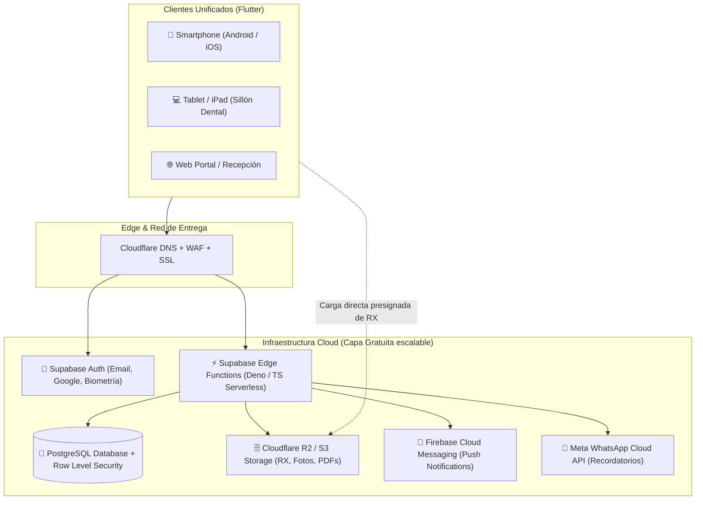
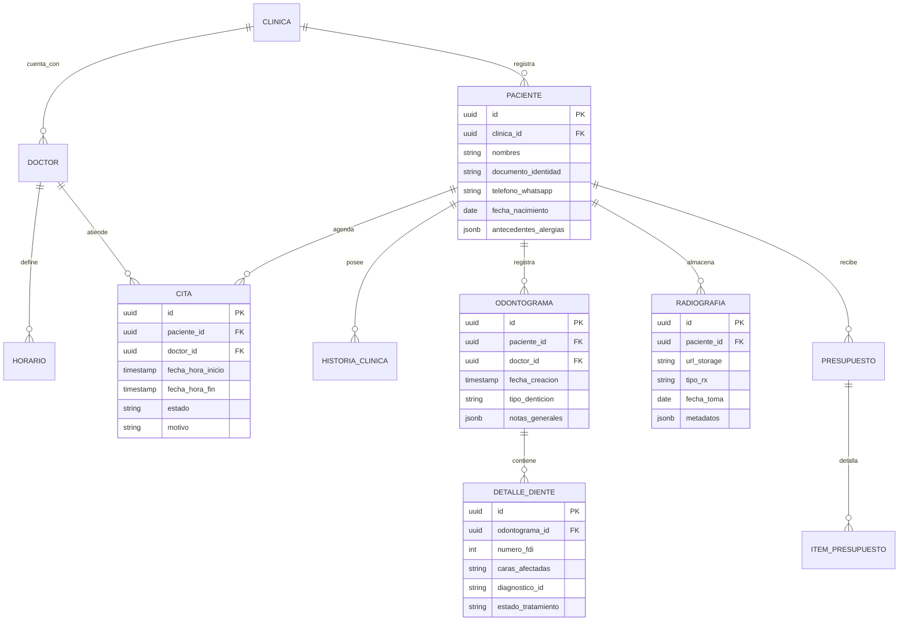
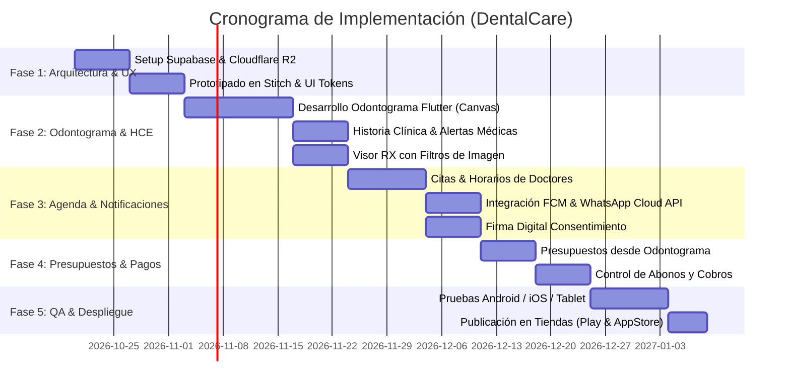

# Plan Maestro de Arquitectura y Desarrollo: DentalCare Cloud Platform

## 1. Resumen Ejecutivo y Enfoque Técnico Seleccionado

Se ha seleccionado el **Enfoque A (Flutter Multiplataforma)** como núcleo del desarrollo cliente. Este enfoque permite crear una sola base de código en **Dart** que compila de forma nativa para **Android, iOS, Tablets/iPads y Web**, garantizando:
- **Reducción de costos y tiempos en un 50%**: Un solo equipo y ciclo de vida de mantenimiento.
- **Rendimiento gráfico óptimo**: Motor gráfico propio (Impeller/Skia) para renderizado fluido a 60/120 fps del **Odontograma interactivo** (zoom, pan, selección táctil de caras dentales) y el **visor de radiografías digitales**.
- **Diseño unificado responsive**: Adaptación natural para smartphone en movilidad y modo split-panel en tablet/iPad para uso directo en el sillón dental.

Toda la infraestructura adyacente es **100% Cloud-Native**, comenzando con una **capa gratuita sólida (Tier Gratis)** que permite operar sin costos de servidores en fase inicial y migrar de forma elástica a **pago por uso (Pay-as-you-grow)** al aumentar la base de clínicas y pacientes.

---

## 2. Arquitectura Cloud-Native End-to-End

---

## 3. Matriz de Servicios en la Nube: Capa Gratuita vs. Escalamiento de Pago

Todos los proveedores elegidos fueron evaluados bajo la premisa de **cero costo inicial** y **escalabilidad transparente**:

| Capa del Sistema | Servicio Cloud Elegido | Beneficios de la Capa Gratuita (Free Tier) | Modelo de Escalamiento a Pago |
| :--- | :--- | :--- | :--- |
| **Base de Datos Relacional** | **Supabase (PostgreSQL)** | - Hasta 500 MB de base de datos dedicada. - Row Level Security (RLS) nativo para seguridad médica. - Extensiones PostGIS/pgvector incluidas. | **Pro ($25/mes)**: 8 GB disco, backups diarios automáticos por 7 días, soporte para miles de pacientes. |
| **Autenticación & Usuarios** | **Supabase Auth** | - Hasta **50,000 usuarios activos mensuales (MAU)** gratis. - Login con Email, Magic Link, Google y tokens JWT. | Incluido en el plan Pro o $0.00324 por usuario adicional. |
| **Almacenamiento RX y Fotos** | **Cloudflare R2** *(Compatible S3)* | - **10 GB/mes de almacenamiento gratuito**. - **$0 COSTO POR EGRESO DE DATOS** (descargas de radiografías ilimitadas sin penalización). | **$0.015 / GB-mes** (la mitad del costo de AWS S3 y sin cobro por transferencia de datos). |
| **Lógica Backend / Serverless** | **Supabase Edge Functions** *(Deno)* | - **500,000 invocaciones/mes gratuitas**. - Despliegue global en milisegundos junto a la BD. | $2 por millón de invocaciones adicionales. |
| **Recordatorios WhatsApp** | **Meta WhatsApp Cloud API** | - **1,000 conversaciones de servicio gratis al mes** iniciadas por el usuario. - Plantillas oficiales de citas. | Micropagos por conversación saliente de utilidad (~$0.03 - $0.05 según país). |
| **Notificaciones Push Móviles** | **Firebase Cloud Messaging (FCM)** | - **100% GRATUITO E ILIMITADO** de por vida tanto para Android como iOS. | $0 (Servicio gratuito permanente de Google). |
| **Hosting Web / Portal Paciente** | **Cloudflare Pages / Vercel** | - Ancho de banda ilimitado, SSL automático, CDN mundial gratuito. | $20/mes solo si se requiere equipo colaborativo enterprise. |

---

## 4. Módulos del Sistema: Core Clínico y Nuevas Tendencias (2025–2026)

### 4.1 Módulos Core (Esenciales)
1. **Gestión de Horarios y Disponibilidad**:
   - Franjas de atención por doctor, control de sillones disponibles, descansos y bloqueos de agenda.
2. **Citas y Agenda Inteligente**:
   - Vistas: Diaria, Semanal, Mensual y Modo Turno de Sillón.
   - Estados dinámicos: *Programada*, *Confirmada*, *En Sala de Espera*, *En Atención*, *Finalizada*, *Cancelada*.
3. **Historia Clínica Electrónica (HCE)**:
   - Ficha médica general, antecedentes sistémicos (Diabetes, Hipertensión, Cardiopatías).
   - **Badges de Alerta Médica**: Alertas visuales destacadas para Alergias críticas (Penicilina, Látex, Anestésicos).
   - Notas de evolución con formato SOAP (Subjetivo, Objetivo, Análisis, Plan).
4. **Odontograma Interactivo Digital (Canvas)**:
   - Nomenclatura internacional **FDI (ISO 3950)**: Dentición permanente (32 dientes) y decidua/infantil (20 dientes).
   - Mapeo táctil individual por caras: Vestibular, Palatina/Lingual, Mesial, Distal y Oclusal/Incisal.
   - Codificación visual estandarizada:
     - 🔴 **Rojo**: Patología activa (Caries, fractura, lesión periapical).
     - 🔵 **Azul**: Tratamiento existente en buen estado (Obturación en resina/amalgama, corona).
     - 🟡 **Amarillo**: Tratamiento planificado/presupuestado.
     - 🟢 **Verde**: Tratamiento ejecutado en la sesión de hoy.
   - Símbolos gráficos para endodoncias, implantes, sellantes, extracciones y prótesis fija/removible.
5. **Visor de Radiografías y Registro Fotográfico Clínico**:
   - Soporte para RX periapicales, panorámicas (ortopantomografías) y fotografía intraoral.
   - Herramientas diagnósticas en pantalla: Inversión de color (negativo), ajuste de brillo/contraste, zoom de alta resolución sin pixelado.
   - Módulo comparativo de imágenes "Antes vs. Después" para presentación estética al paciente.

### 4.2 Módulos Nuevos según Tendencias del Sector
1. **Consentimiento Informado Digital con Firma Biométrica/Táctil**:
   - Firma legal directa en la pantalla del dispositivo móvil o tablet.
   - Sellado automático en PDF inmutable con hash SHA-256 y marca de tiempo.
2. **Presupuestos Dinámicos vinculados al Odontograma**:
   - Generación automática de presupuesto a medida que se seleccionan piezas y caras con patologías.
   - Plan de tratamiento por fases de prioridad (Fase 1: Urgencias/Higiene; Fase 2: Operatoria; Fase 3: Rehabilitación/Ortodoncia).
3. **Automatización de WhatsApp (Reducción de No-Shows)**:
   - Recordatorio automático 24h y 2h antes de la cita con botones de confirmación rápida ("Confirmar" / "Reagendar").
4. **Facturación, Planes de Pago y Control de Abonos**:
   - Registro de anticipos, pagos por sesión y balance pendiente por paciente.
5. **Control de Inventario y Alertas de Caducidad**:
   - Monitoreo de stock de resinas, anestesias, guantes y biomateriales con alerta preventiva de fecha de vencimiento.
6. **Dictado Clínico por Voz (Hands-Free)**:
   - Uso del reconocimiento de voz nativo del dispositivo para redactar notas clínicas sin necesidad de retirarse los guantes esterilizados.

---

## 5. Diseño UX/UI Moderno con Apoyo de Stitch

- **Estilo Visual**: *Clean Modern Medical* con estética limpia, tipografía legible (Inter/Plus Jakarta Sans) y contraste clínico seguro.
- **Paleta de Color Base**:
  - Color Primario (Salud y Confianza): `Teal / Turquesa Médico` (`#00A896` / `#028090`).
  - Color Secundario (Tranquilidad): `Azul Soft` (`#2A9D8F`).
  - Color de Fondo: Modo Claro (`#F8FAFC`), Modo Cirugía/Dark (`#0F172A`).
  - Alertas Clínicas: Caries/Urgencia (`#E63946`), Alergias Críticas (`#D90429`).
- **Uso de Stitch**: Creación rápida de prototipos interactivos, pruebas de usabilidad del odontograma táctil en tablets y exportación de tokens de diseño para Flutter.

---

## 6. Modelo de Datos Relacional Inicial (PostgreSQL)

---

## 7. Plan de Implementación por Fases

---

## 8. Seguridad y Cumplimiento Normativo de Salud
- **Cifrado Integral**: Cifrado en reposo AES-256 para radiografías en Cloudflare R2 y TLS 1.3 para todo el tráfico de datos.
- **Aislamiento de Datos Médicos (RLS)**: Ningún doctor o clínica puede ver datos de otra clínica en la base de datos gracias a las directivas Row Level Security a nivel de motor PostgreSQL.
- **Respaldos Automatizados**: Backups automáticos de base de datos en nube para recuperación ante desastres sin intervención manual.
