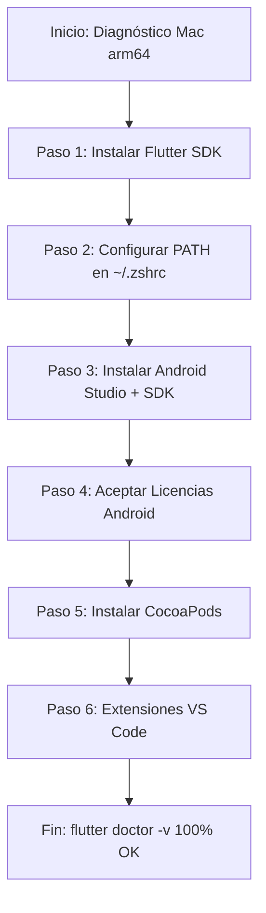

# Plan de Requisitos del Entorno de Desarrollo: DentalCare App

## 1. Diagnóstico Actual de tu Mac (Auditoría en Tiempo Real)

Tras auditar tu sistema (macOS con procesador **Apple Silicon `arm64`**), este es el estado actual de tus herramientas:

| Componente | Estado Detectado | Versión / Detalle | Acción Requerida |
| :--- | :---: | :--- | :--- |
| **Procesador & Arquitectura** | ✅ Listo | Apple Silicon (`arm64` M1/M2/M3/M4) | Descargar siempre binarios nativos ARM64. |
| **Gestor de Paquetes** | ✅ Listo | Homebrew 7.0.6 en `/opt/homebrew` | Ninguna, listo para instalar herramientas. |
| **Java JDK** | ✅ Listo | OpenJDK Temurin 25.0.3 LTS | Compatible con Android SDK. |
| **Editor de Código** | ✅ Listo | Visual Studio Code (`/Applications`) | Instalar extensiones de Flutter y Dart. |
| **Command Line Tools** | ✅ Listo | `/Library/Developer/CommandLineTools` | Base de compilación C/C++ lista. |
| **Git & Repositorio** | ✅ Listo | Git 2.54.0 conectado a GitHub | Repositorio activo y sincronizado. |
| **Flutter SDK** | ❌ **Pendiente** | No encontrado en `$PATH` | **Instalación prioritaria**. |
| **Android Studio & SDK** | ❌ **Pendiente** | No instalado | **Requerido para Android/Tablet**. |
| **CocoaPods** | ❌ **Pendiente** | No encontrado | **Requerido para compilar iOS/iPad**. |
| **Xcode Completo** | ⚠️ Opcional inicial | Solo Command Line Tools | Requerido para simuladores de iPhone/iPad. |

---

## 2. Hoja de Ruta de Instalación (Paso a Paso)



---

### Paso 1: Instalación de Flutter SDK (Apple Silicon)

Tienes dos alternativas confiables:

#### Alternativa A (Recomendada vía Homebrew):
Abre tu terminal y ejecuta:
```bash
brew install --cask flutter
```

#### Alternativa B (Manual Oficial):
1. Descarga el paquete oficial para Apple Silicon (ARM64) desde:
   👉 [https://docs.flutter.dev/get-started/install/macos/mobile-ios](https://docs.flutter.dev/get-started/install/macos/mobile-ios)
2. Crea una carpeta de desarrollo y descomprime el SDK:
   ```bash
   mkdir -p ~/development
   cd ~/development
   unzip ~/Downloads/flutter_macos_arm64_*.zip
   ```

---

### Paso 2: Configuración de Variables de Entorno (`PATH`)

Añade Flutter a tu archivo de configuración de terminal `~/.zshrc`:

```bash
echo 'export PATH="$HOME/development/flutter/bin:$PATH"' >> ~/.zshrc
source ~/.zshrc
```
*(Si lo instalaste vía Homebrew en el Paso 1, Homebrew ya lo vincula automáticamente en `/opt/homebrew/bin`)*.

Verifica la versión:
```bash
flutter --version
```

---

### Paso 3: Instalación de Android Studio y Android SDK

Para compilar hacia teléfonos y tablets Android:

1. **Instalar Android Studio**:
   ```bash
   brew install --cask android-studio
   ```
   *(O descárgalo desde [developer.android.com/studio](https://developer.android.com/studio) seleccionando la versión "Mac with Apple chip")*.

2. **Configuración inicial en Android Studio**:
   - Abre Android Studio y completa el asistente de bienvenida (*Standard Setup*).
   - Ve a **Settings / Preferences** > **Languages & Frameworks** > **Android SDK**:
     - En la pestaña **SDK Platforms**: Asegúrate de tener marcada una versión reciente (Android 14 o 15 / API 34+).
     - En la pestaña **SDK Tools**: Marca obligatoriamente:
       - ✅ **Android SDK Build-Tools**
       - ✅ **Android SDK Command-line Tools (latest)** *(Crítico para Flutter)*
       - ✅ **Android Emulator**
       - ✅ **Android SDK Platform-Tools**
   - Haz clic en **Apply** para que descargue los componentes.

---

### Paso 4: Aceptación de Licencias de Android

Una vez instalado el Android SDK Command-line Tools, ejecuta en la terminal:
```bash
flutter doctor --android-licenses
```
*Presiona `y` (yes) a cada una de las licencias solicitadas*.

---

### Paso 5: Instalación de CocoaPods (Para iOS y iPad)

CocoaPods es el gestor de dependencias nativas para los plugins de iOS (como cámara, escaneo de fotos y firmas):

Ejecuta con Homebrew:
```bash
brew install cocoapods
```

Verifica:
```bash
pod --version
```

---

### Paso 6: Configuración de Xcode (Para Compilar en iOS/iPad)

- **Instalación**: Abre la **Mac App Store** y busca **Xcode**. Descárgalo e instálalo (~12 GB).
- Tras instalarlo, abre la terminal y configura las herramientas de desarrollo:
  ```bash
  sudo xcode-select --switch /Applications/Xcode.app/Contents/Developer
  sudo xcodebuild -runFirstLaunch
  ```
- Para habilitar simuladores de iPhone y iPad:
  ```bash
  open -a Simulator
  ```

---

### Paso 7: Extensiones Esenciales en Visual Studio Code

Dado que ya tienes instalado Visual Studio Code, instala estas extensiones oficiales:

1. **Flutter** (`Dart-Code.flutter`): Soporte de depuración, hot reload y autocompletado.
2. **Dart** (`Dart-Code.dart-code`): Analizador estático de código Dart.
3. **Error Lens** (`usernamehw.errorlens`): Muestra errores y warnings en línea en tiempo real.
4. **Material Icon Theme** o similar para identificar íconos de Flutter y Supabase.

Puedes instalarlas con estos comandos:
```bash
code --install-extension Dart-Code.flutter
code --install-extension Dart-Code.dart-code
code --install-extension usernamehw.errorlens
```

---

## 3. Comandos de Verificación del Entorno

Cuando hayas completado las instalaciones, ejecuta en tu terminal:

```bash
flutter doctor -v
```

El resultado esperado debe ser similar a:
```text
[✓] Flutter (Channel stable, 3.22.x, on macOS arm64, locale es-419)
[✓] Android toolchain - develop for Android devices (Android SDK version 34.0.0)
[✓] Xcode - develop for iOS and macOS (Xcode 15.x / 16.x)
[✓] Chrome - develop for the web
[✓] Android Studio (version 2024.x)
[✓] VS Code (version 1.9x)
[✓] Connected device (2 available: macOS, Chrome, Emuladores)
[✓] Network resources
• No issues found!
```

---

## 4. Primer Test de Ejecución de DentalCare

Una vez que `flutter doctor` esté en verde, podrás probar la app recién arquetipada con:

```bash
cd /Users/jhuertad/Desktop/cursos/app_odontologia

# Descargar las librerías del proyecto
flutter pub get

# Ejecutar en el navegador Web (el más rápido sin configurar emuladores previos)
flutter run -d chrome

# O ejecutar en emulador Android
flutter run -d android
```

---

## 5. Resumen de Espacio en Disco Requerido
- **Flutter SDK**: ~2.5 GB
- **Android Studio + Android SDK + Emulador**: ~8 GB
- **Xcode + Simuladores iOS** *(Opcional para fase Android inicial)*: ~15 GB
- **Espacio libre recomendado en Mac**: Mínimo **25 - 30 GB**.
